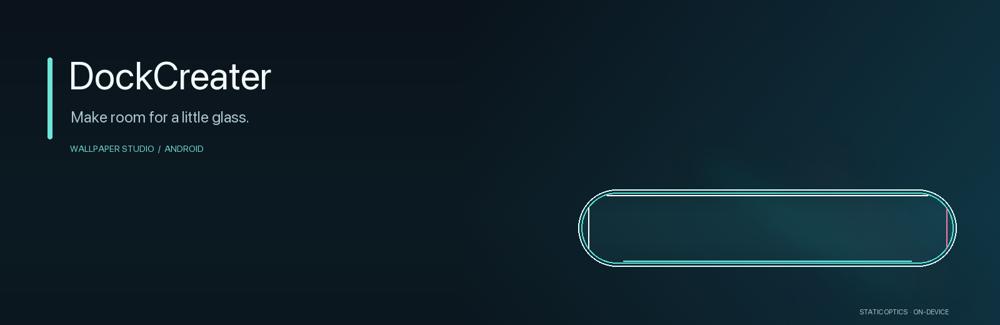
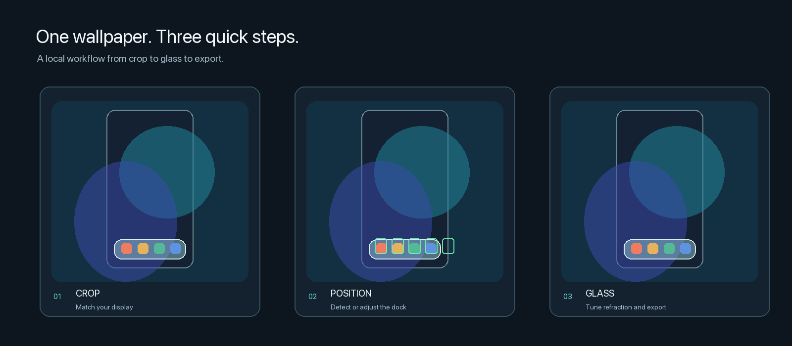
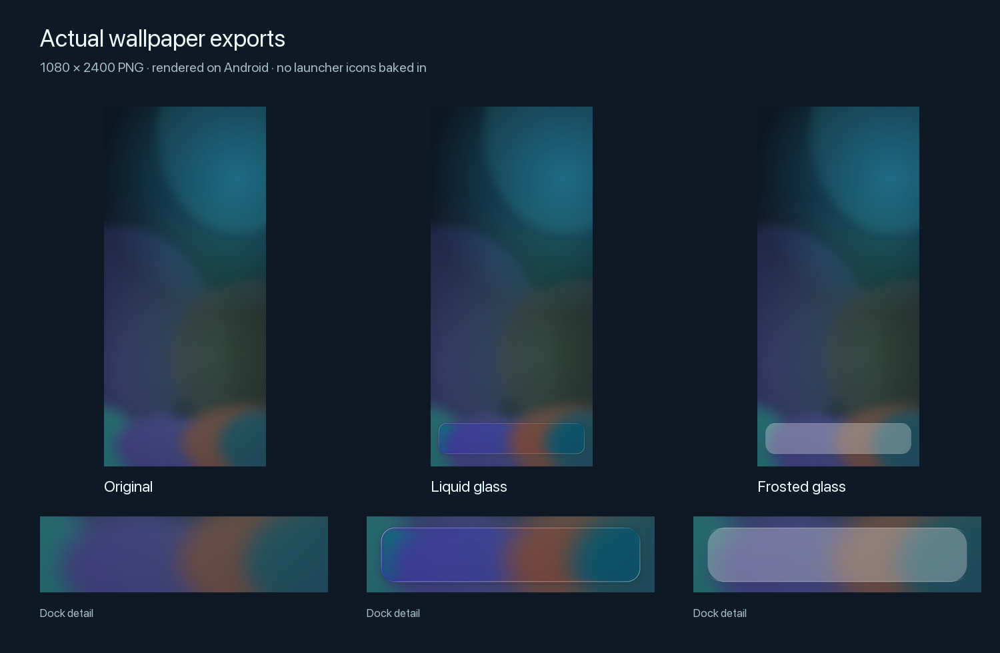
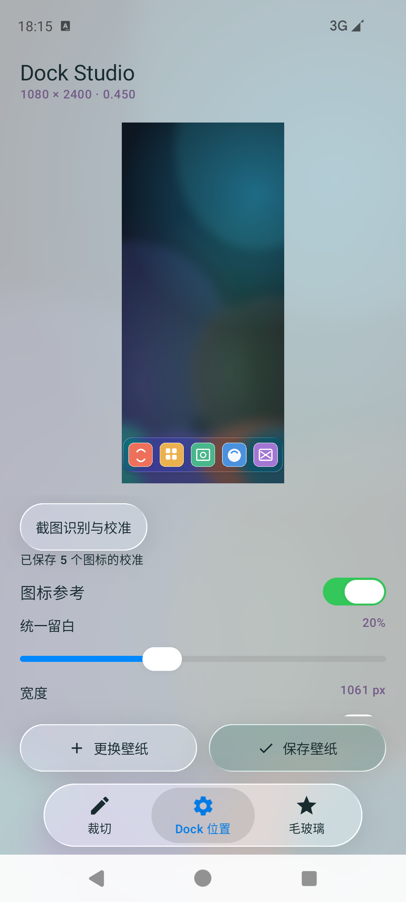
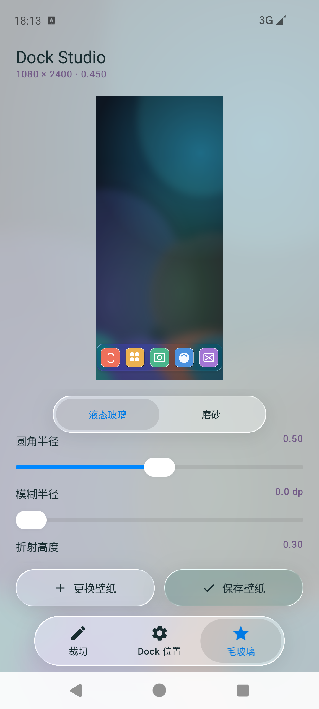
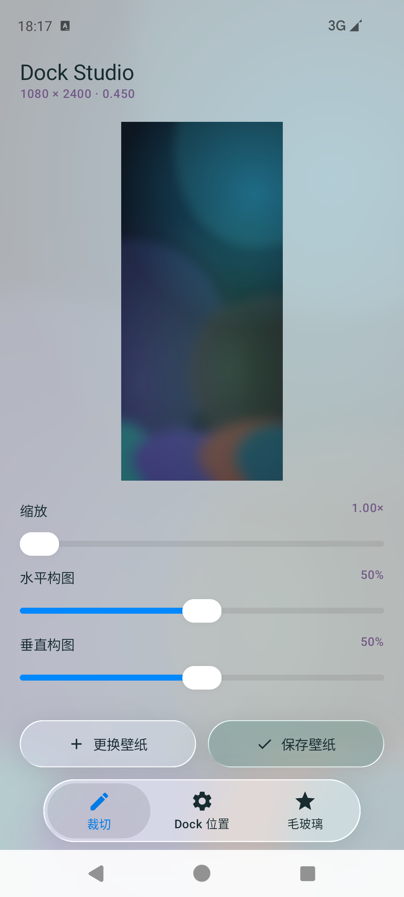

<p align="center">
  
</p>

<h1 align="center">DockCreater</h1>

<p align="center">把一张壁纸，变成带自定义玻璃 Dock 的桌面壁纸。</p>

<p align="center">
  <a href="README.md">English</a> · Android 12+ · Kotlin · Jetpack Compose · MIT（第三方代码另有许可）
</p>

<p align="center">
  
</p>

## 下载

**[下载已签名 Android APK](https://github.com/Macchen666816/DockCreater/releases/latest)** — Android 12+ / ARM64。在 Assets 中选择 `DockCreater-1.0.3-arm64-release.apk`；Source code 压缩包不是安装包。Release 同时提供 SHA-256 校验文件。

安装包沿用项目原有 Release 签名，可覆盖同证书的旧版 Release；Debug 包签名不同，不能直接覆盖。

## 实际导出的壁纸



这些是通过应用 CPU 渲染器和 MediaStore 导出流程，在 Android 13 ARM64 模拟器上实际生成的 1080 × 2400 PNG。下排是导出图片的 Dock 区域放大；没有额外合成桌面图标或玻璃效果。

查看全分辨率 PNG：[原图](docs/assets/wallpaper-original.png) · [液态玻璃](docs/assets/wallpaper-liquid.png) · [磨砂毛玻璃](docs/assets/wallpaper-frosted.png)。

## 功能

DockCreater 会根据手机屏幕比例处理壁纸，并在图像上渲染 Dock 形状的玻璃区域。导入图片后，可以裁切、调整或识别 Dock 位置、调节玻璃效果，最后导出全分辨率 PNG。

- **适配壁纸尺寸。** 读取当前显示区域的逻辑尺寸，按屏幕比例裁切，并按该尺寸导出。
- **设置 Dock 位置。** 可以手动调整大小和位置，也可以用 OpenCV 分析桌面截图；识别结果需要用户确认。
- **选择玻璃效果。** 提供高斯模糊毛玻璃和静态液态玻璃。液态玻璃可调圆角、模糊、折射高度、折射量和色差。
- **预览与导出。** Android 13+ 使用 AGSL 提供流畅的液态玻璃实时预览；Android 12 和全分辨率 PNG 导出使用 CPU 渲染。
- **本地处理。** 壁纸处理与导出均在设备上完成。应用未声明 `INTERNET` 权限，不会上传壁纸。

<p align="center">
  
  
  
</p>

上方截图来自使用原创样例图运行的 Android 应用。你也可以用这张[合成桌面截图](docs/assets/demo-homescreen.png)试用识别流程。

## 兼容性

| 项目 | 支持情况 |
|---|---|
| Android | Android 12（API 31）及以上 |
| 当前安装包 ABI | 仅 `arm64-v8a` |
| 液态玻璃实时预览 | Android 13+ 使用 AGSL；Android 12 使用 CPU |
| 导出 | 设备端渲染全分辨率 PNG |
| 桌面启动器 | 可读取显示尺寸；各厂商仍可能自行缩放壁纸或应用视差 |

当前应用界面为中文。英文 README 不代表应用已有英文界面。本项目主要供个人使用；其他厂商桌面和未实测设备仍需进一步验证。

## 从源码构建

1. 安装 Android Studio、Android SDK Platform 37，并准备 Android 12+ ARM64 设备或模拟器。
2. 在 Android Studio 中打开仓库并完成 Gradle 同步。项目使用 Gradle Wrapper 和仓库内的 Gradle JDK 配置；按 Android Studio 的 Gradle JDK 设置及 `gradle/gradle-daemon-jvm.properties` 选择工具链。
3. 运行 `app` 配置，或构建 Debug APK：

   ```sh
   ./gradlew assembleDebug
   ```

Debug APK 位于 `app/build/outputs/apk/debug/`。Release 构建需要在仓库之外配置签名密钥。不要提交签名属性、密钥库、密码或个人 Release 密钥；签名不同的 APK 不能覆盖安装升级。

## 项目文档

- [架构与渲染管线](docs/architecture.md)
- [测试与已知限制](docs/testing.md)
- [第三方许可证与声明](THIRD_PARTY_NOTICES.md)

## 许可证

DockCreater 原创代码与文档采用 [MIT 许可证](LICENSE)，适用范围见[第三方声明](THIRD_PARTY_NOTICES.md)。改编自 Backdrop 的代码和所用依赖仍遵循各自许可证。
